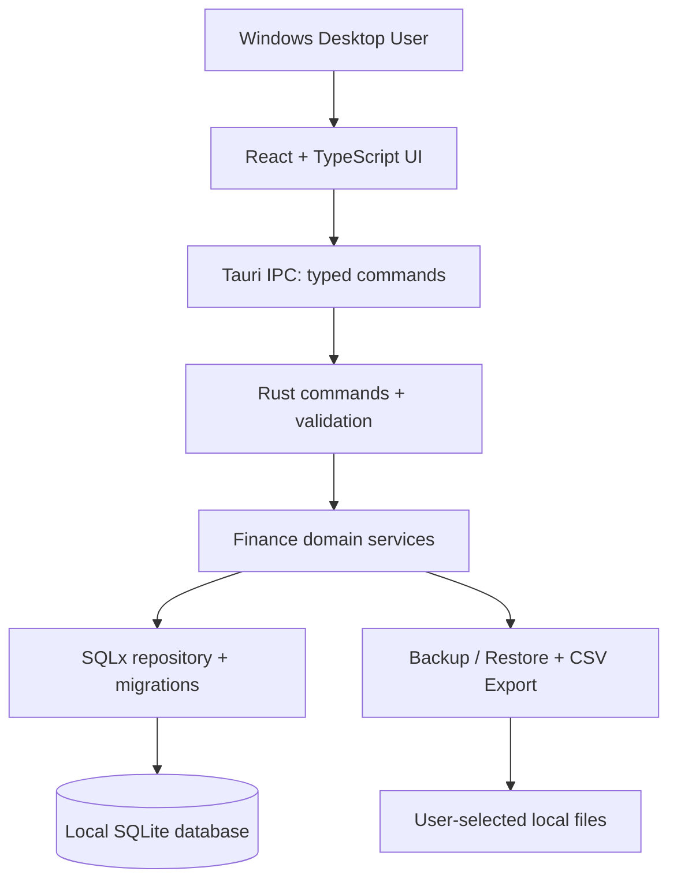
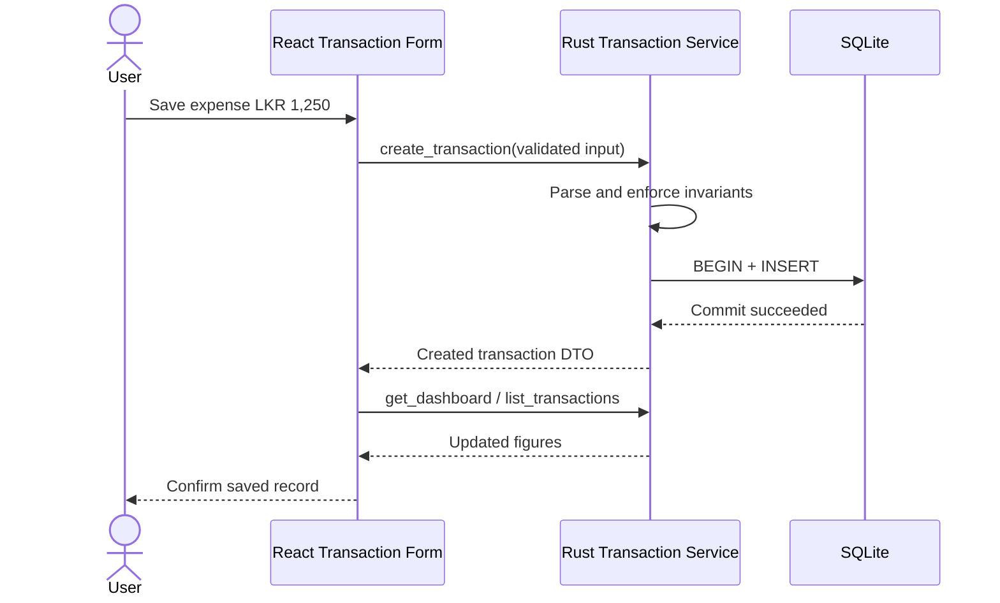
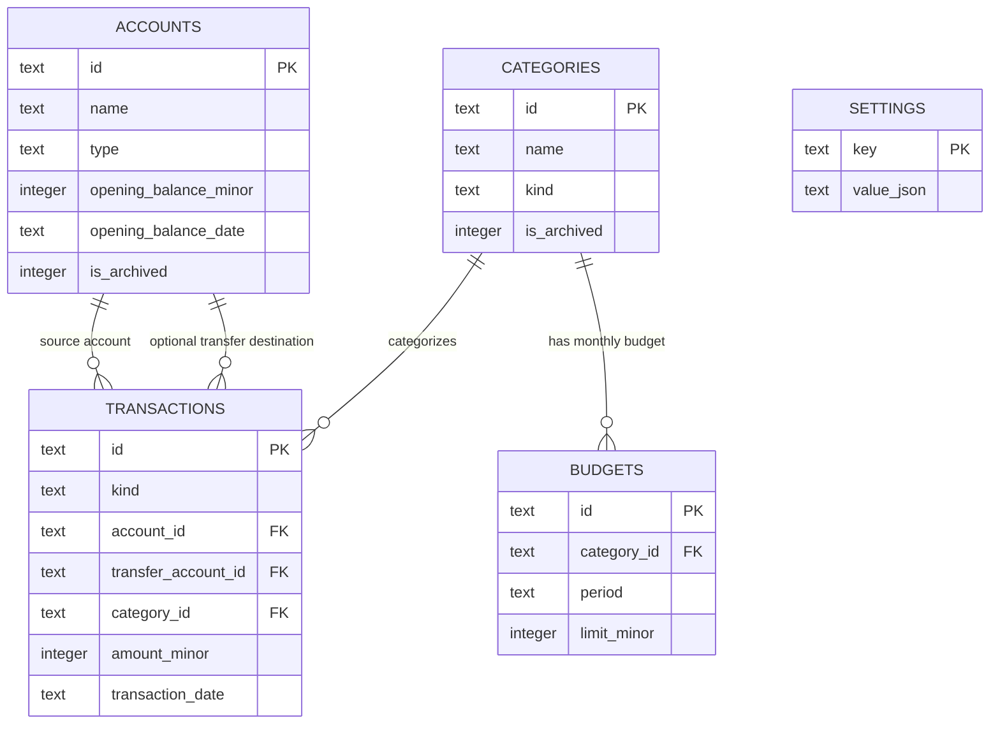

# FinTrack — Personal Finance Manager (Offline)

> **Complete Project Report & Development Blueprint**  
> **Target:** Windows desktop application · **Architecture:** Offline-first · **Primary language:** Rust  
> **Stack:** Tauri 2 + React + TypeScript + Tailwind CSS + SQLite + SQLx  
> **Document version:** 1.0 · **Prepared:** 20 October 2026 · **Status:** Development plan only 
> **Suggested license:** MIT for your original code (review third-party licenses separately)

---

## Table of Contents

1. [Executive Summary](#1-executive-summary)
2. [Problem Statement and Objectives](#2-problem-statement-and-objectives)
3. [Project Scope and Release Strategy](#3-project-scope-and-release-strategy)
4. [Target Users and Use Cases](#4-target-users-and-use-cases)
5. [Functional Requirements](#5-functional-requirements)
6. [Nonfunctional Requirements](#6-nonfunctional-requirements)
7. [Technology Stack and Design Decisions](#7-technology-stack-and-design-decisions)
8. [System Architecture](#8-system-architecture)
9. [Accounting Rules and Calculations](#9-accounting-rules-and-calculations)
10. [Database Design](#10-database-design)
11. [UI/UX Plan](#11-uiux-plan)
12. [Rust–Frontend Interface](#12-rustfrontend-interface)
13. [Security, Privacy, Backup and Recovery](#13-security-privacy-backup-and-recovery)
14. [Development Environment and Initial Setup](#14-development-environment-and-initial-setup)
15. [Suggested Repository Structure](#15-suggested-repository-structure)
16. [Step-by-Step Implementation Plan](#16-step-by-step-implementation-plan)
17. [Testing and Quality Assurance](#17-testing-and-quality-assurance)
18. [Release, Installation and Maintenance](#18-release-installation-and-maintenance)
19. [Milestones, Deliverables and Schedule](#19-milestones-deliverables-and-schedule)
20. [Risks and Mitigations](#20-risks-and-mitigations)
21. [Future Roadmap](#21-future-roadmap)
22. [Definition of Done](#22-definition-of-done)
23. [Developer Work Log and Git Strategy](#23-developer-work-log-and-git-strategy)
24. [References and Official Documentation](#24-references-and-official-documentation)
25. [First Development Session Checklist](#25-first-development-session-checklist)

---

## 1. Executive Summary

**FinTrack** is a private, offline-first personal finance desktop application for Windows. Its primary purpose is to help an individual record daily financial activity, see accurate account balances, understand spending patterns, and plan monthly budgets—without needing an internet connection or cloud account.

**Value proposition:** Record a transaction in seconds; see correct balances, budgets and reports immediately.

The software is built as a **Tauri 2** desktop application: **React + TypeScript** renders the interface, **Rust** validates finance operations and owns the database-access boundary, and **SQLite** stores records locally. Users can export their own data and create recoverable backups. All core workflows work offline.

### Project profile

| Item | Decision |
|---|---|
| Working name | FinTrack — Personal Finance Manager |
| Product | Installed Windows desktop software |
| Target user | One person, using one Windows PC |
| Initial currency | Sri Lankan rupee (LKR), 2 decimal places |
| Initial account types | Cash, bank, e-wallet, other asset-like cash accounts |
| Storage | Local SQLite database |
| Connectivity | No internet needed for core functions |
| UI | Responsive desktop layout, light/dark theme |
| Design principle | Privacy and correct calculations over feature quantity |
| MVP priority | Accounts, transactions, categories, dashboard, budgets, backup/restore |
| Future scope | Recurring records, goals, debts, import, reports, optional encrypted sync |

> **Important scope distinction:** FinTrack is a *personal cash-flow and account-tracking* tool, not a full bookkeeping/general-ledger package, tax advisory product, banking service or investment adviser. It does not connect to bank accounts in the MVP.

### Success criteria for the first usable release

- The user can create an account and enter its starting balance.
- The user can record income, expenses and transfers without double-counting.
- Account balances and monthly cash flow remain correct after additions, edits and deletions.
- Monthly budgets and expense breakdowns use accurate transaction data.
- All data survives closing and reopening the app.
- The user can export records and successfully restore a backup on a fresh installation.
- The app works with Wi-Fi turned off and ships as a Windows installer.

---

## 2. Problem Statement and Objectives

### 2.1 Problem

Personal financial activity is often dispersed across cash, accounts, text notes, receipts and spreadsheet files. This makes it difficult to answer basic questions:

- How much money is currently available across my accounts?
- Where did I spend money this month?
- Did I spend more than I earned during a selected period?
- Am I close to exceeding my food or transport budget?
- Can I recover my records if my computer fails?

Spreadsheet tools can solve some of these needs but may require repetitive manual formulas and do not necessarily validate transfers or prevent inconsistent records.

### 2.2 Main objective

**Design, implement, test and package a reliable, private Windows application for day-to-day personal cash-flow tracking.**

### 2.3 Specific objectives

1. Design an intuitive dashboard and fast transaction-entry workflow.
2. Create local account and category management.
3. Implement trustworthy finance calculations using integer monetary values.
4. Enforce validation and database integrity in the Rust layer.
5. Show period-based reports and spending trends.
6. Build a local backup-and-restore workflow with verification.
7. Produce a versioned, testable Windows desktop installer.
8. Maintain a clear, maintainable codebase suitable for a portfolio project.

### 2.4 Intended outcomes

**For the user:** less manual record keeping, greater financial visibility, private local storage.  
**For the developer:** practical experience with Rust, Tauri IPC, React, SQL migrations, financial invariants, application security, testing and Windows distribution.

---

## 3. Project Scope and Release Strategy

### 3.1 Release boundaries

| Capability | MVP v0.1–v1.0 | Post-MVP | Not planned initially |
|---|:---:|:---:|:---:|
| Local account management | ✅ | | |
| Income / expense entry | ✅ | | |
| Transfers between accounts | ✅ | | |
| Categories | ✅ | | |
| Dashboard & monthly summary | ✅ | | |
| Category budgets | ✅ | | |
| Transaction history / filtering | ✅ | | |
| CSV export | ✅ | | |
| Local backup / restore | ✅ | | |
| Dark mode and preferences | ✅ | | |
| Recurring payment templates | | ✅ | |
| Savings goals | | ✅ | |
| Debts / loans | | ✅ | |
| PDF report generation | | ✅ | |
| CSV import with preview | | ✅ | |
| App-level database encryption | | ✅ | |
| Multiple currencies | | ✅ | |
| Mobile companion / encrypted sync | | ✅ | |
| Direct banking integration | | | ✅ |
| Ads, accounts, analytics trackers | | | ✅ |
| AI advice or automatic spending judgement | | | ✅ |

**Interpretation:** ✅ in the final column means deliberately excluded from the initial project. No cloud backend, external bank connection or account registration is required.

### 3.2 Strict MVP principle

**Finish accuracy and backup before building sophisticated visuals or AI features.** A reliable finance tracker with 8 polished features is more valuable than a flashy interface with incorrect balances.

### 3.3 Explicit exclusions

- No direct access to bank credentials, PINs or card details.
- No loan application, lending, financial product recommendations or investment trading.
- No unattended cloud upload of financial records.
- No mandatory registration, paid service or server dependency.
- No attempt to serve multiple simultaneously writing devices in the MVP.

---

## 4. Target Users and Use Cases

### 4.1 Primary user persona

An individual who uses a Windows laptop or desktop, records personal expenses in LKR, uses a mixture of cash and bank accounts, and wants fast entry plus monthly summaries.

### 4.2 Primary usage scenarios

| ID | Scenario | Expected result |
|---|---|---|
| UC-01 | Start application for the first time | Friendly onboarding and empty database creation |
| UC-02 | Create a cash account with opening balance | Account appears on dashboard |
| UC-03 | Record a food expense | Account balance decreases; food report increases |
| UC-04 | Record salary as income | Selected account balance and monthly income increase |
| UC-05 | Move money from bank to cash | Bank decreases, cash increases, total unchanged |
| UC-06 | Change a mistaken transaction | Derived balances update correctly |
| UC-07 | Filter expenses by month/category | Only matching records are returned |
| UC-08 | Set monthly food budget | Budget progress and warning threshold update |
| UC-09 | Export transactions | Valid UTF-8 CSV is created |
| UC-10 | Backup and restore the database | Data is recovered after integrity checks |

### 4.3 Essential user stories

- **As a user,** I want a one-click “Add transaction” button so that logging a purchase is fast.
- **As a user,** I want to choose which account was affected so that account balances match reality.
- **As a user,** I want transfers to remain separate from income/expenses so that reports do not inflate totals.
- **As a user,** I want to view any previous month so that I can compare periods.
- **As a user,** I want to undo accidental deletion so that I can correct a mistake safely.
- **As a user,** I want local backups so that I am not dependent on an online account.

---

## 5. Functional Requirements

Requirement codes are useful for connecting implementation tasks with tests.

### FR-01: First-run onboarding

- Select preferred name for the app profile (optional, purely local).
- Set default currency to **LKR** and decimal precision to **2** for the MVP.
- Create the first account and specify an opening balance and tracking start date.
- Offer starter expense categories (Food, Transport, Utilities, Shopping, Education, Health, Other) and income categories (Salary, Freelance, Gifts, Other).
- Finish with an empty-state dashboard and a clearly visible transaction button.

**Acceptance:** Restarting does not repeat onboarding, and the first account appears with exactly the entered balance.

### FR-02: Account management

Each account has: ID, name, type, opening balance, tracking start date, archived flag and timestamps.

User actions: create, rename, view balance/history, edit metadata and archive. Do not hard-delete an account containing transactions. Provide a clear confirmation for opening-balance changes because these change all derived balances.

**Rule:** MVP accounts represent cash-like holdings. Credit-card liabilities or debts require separate modeling in a later release.

### FR-03: Category management

- Create, rename, color-tag and archive expense or income categories.
- Categories are **typed**: income categories are not valid for expense transactions and vice versa.
- Existing transactions keep their category association after a category is archived.
- Prevent destructive deletion of referenced categories.

### FR-04: Transaction management

Fields:

| Field | Requirement |
|---|---|
| Date | User-selected local calendar date |
| Kind | `income`, `expense` or `transfer` |
| Amount | Positive, up to configured safe maximum, ≤2 decimal places for LKR |
| Source account | Mandatory |
| Destination account | Mandatory for transfer, otherwise absent |
| Category | Mandatory for income/expense, absent for transfer |
| Payee / description | Optional text |
| Notes | Optional text |

Actions: create, list, filter, search, edit, delete after confirmation, and duplicate as a new record. Deleting a transaction *removes its financial effect*; for a mistaken entry, consider a soft-delete/undo policy in a later release.

**Acceptance:** Changes are persisted atomically and summaries are updated consistently.

### FR-05: Dashboard

Display for chosen month:

- **Total tracked account balance** = current balances across active cash-like accounts; label correctly and allow archived-account visibility.
- **Monthly income** = sum of income transactions during the month.
- **Monthly expenses** = sum of expense transactions during the month.
- **Net cash flow** = income − expenses.
- Expense breakdown by category.
- Recent transactions with search / “View all.”
- Budget progress cards.
- Fast transaction-entry action.

Clarify the difference between **current total account balance** (all recorded history + opening balances) and **monthly net cash flow** (selected period only).

### FR-06: Budget management

- Monthly limit per expense category.
- Show spent amount, amount remaining and utilization percentage.
- Support past, current and future months.
- Visual thresholds proposed: 80% (approaching limit), 100% (reached/exceeded). These are UI settings, not financial rules.
- Permit negative remaining budget values when overspent; do not prevent recording a genuine expense.

### FR-07: Transaction history

- Filter by inclusive start/end dates (implemented as `[start, day_after_end)`).
- Filter by kind, account and category; text search notes/payee.
- Sort by transaction date descending, then creation timestamp/ID.
- Paginate or virtualize large result sets.
- Display and export visible filter criteria.

### FR-08: Export

- Export transaction history to `.csv` in a user-selected location.
- Include ISO date, type, source/destination account names, category, amount in decimal string format, currency and note.
- Use proper CSV quoting and UTF-8 encoding.
- Spreadsheet formula injection protection: escape or prefix fields that start with `=`, `+`, `-`, `@` or tab where appropriate, especially user-supplied text.
- Do not export sensitive filesystem paths or application secrets.

### FR-09: Backup and restore

- Choose a destination for a consistent SQLite backup snapshot.
- Display backup location, time and whether the file is protected.
- Restore only after explicit confirmation, verification and creation of a safety copy of current data.
- Handle failed/invalid backups without damaging the current database.
- Provide an on-screen reminder that a second copy on a separate drive protects against local disk failure.

### FR-10: Preferences

- Light/dark/system theme.
- Preferred date display format; persist dates as ISO internally.
- Currency display format (LKR fixed for MVP).
- Optional app start screen and compact transaction entry preferences.
- Version, data location, backup controls and privacy explanation.

---

## 6. Nonfunctional Requirements

| ID | Requirement | Practical target / test |
|---|---|---|
| NFR-01 | Offline operation | Run full core test suite with network disabled |
| NFR-02 | Data correctness | Financial invariants validated in unit + integration tests |
| NFR-03 | Persistence | Data remains after restart and clean OS reboot |
| NFR-04 | Performance | Typical transaction actions feel immediate on target laptop; measure real timings |
| NFR-05 | Scalability | Validate with 10,000+ example transactions |
| NFR-06 | Usability | Add a normal expense in a few interactions |
| NFR-07 | Accessibility | Keyboard navigation, focus indicators, readable contrast |
| NFR-08 | Privacy | No silent analytics, telemetry or network calls |
| NFR-09 | Portability | Native Windows installer; data export is documented |
| NFR-10 | Maintainability | Modular Rust code, typed IPC, database migrations |
| NFR-11 | Recoverability | Restore known backup on fresh installation successfully |
| NFR-12 | Reliability | No partially written transaction records after errors |

Targets for speed, binary size and memory use must be **measured** on a real Windows machine rather than advertised before testing.

---

## 7. Technology Stack and Design Decisions

| Layer | Choice | Rationale |
|---|---|---|
| Native shell | Tauri 2 | Windows packaging, system integration, WebView2 UI |
| Backend | Rust (stable) | Type safety, strong domain model, native performance |
| Frontend | React + TypeScript | Mature component ecosystem, structured state |
| Bundler | Vite (from Tauri template) | Fast local frontend development |
| Styling | Tailwind CSS | Consistent, efficient utility-first UI |
| Components | shadcn/ui (optional) | Accessible primitives that can be customized |
| Charts | Recharts | React-native reporting visuals |
| Icons | Lucide | Consistent iconography |
| Local state | React state; Zustand only when needed | Avoid state-management overhead early |
| Database | SQLite | Embedded, zero server, durable persistence |
| Rust DB access | SQLx with SQLite | Parameterized queries, transactions, migrations |
| Forms | React Hook Form + Zod (optional) | Client validation and friendly errors |
| Tests | Rust `cargo test`, Vitest + RTL, Playwright/desktop smoke tests | Layered quality strategy |
| Packaging | Tauri Windows NSIS `.exe`, optional `.msi` | Standard Windows installation |
| Source control | Git + GitHub | Reproducible project history |

### Architectural decision: no direct SQL plugin in the UI

Tauri has a SQL plugin, but **this design deliberately uses Rust-managed SQLx rather than exposing direct SQL calls to JavaScript**. Every mutation should pass through a typed Rust command, ensuring that amount parsing, account validation, transaction rules, authorization boundary and error handling have one consistent implementation.

**Avoid mixing SQLx and the frontend SQL plugin for the same data access flow** unless there is a specific, well-tested reason.

### Currency strategy

In the MVP, choose **a single accounting currency: LKR**. This avoids silent conversion mistakes. Multicurrency requires additional rules for exchange rates, rounding and historical valuations and belongs in a future module.

### Open-source cost assumption

Rust, Tauri, React and SQLite can be used without a recurring hosted-backend subscription for this offline project. Installation signing certificates, third-party services or store distribution may have separate costs if chosen later.

---

## 8. System Architecture

### 8.1 High-level structure



### 8.2 Responsibility boundaries

**React/TypeScript frontend**
- Pages, modal dialogs, form input, date selection and charts.
- Input hints and basic validation to improve UX.
- Calls typed command wrappers and displays results/errors.
- Never computes authoritative balances or accepts arbitrary SQL from users.

**Tauri IPC**
- Explicit commands between React and Rust.
- Serializes input/output data and propagates safe error messages.
- Exposes only necessary application functions.

**Rust finance domain**
- Validates account, category, kind and amount.
- Parses monetary input into integer minor units.
- Executes atomic create/update/delete operations.
- Calculates balances, budgets and reports.
- Controls import/export and backup permissions.

**SQLx / SQLite**
- Parameterized persistence and indexed queries.
- Unique IDs, foreign keys, check constraints and migrations.
- ACID transactions to prevent inconsistent records.

### 8.3 Lifecycle

1. Application launches and requests its **app-data directory** via Tauri path APIs.
2. Rust opens or creates local SQLite database.
3. Rust configures connections (foreign keys enabled; WAL strategy if appropriate).
4. Database migrations run; failures are surfaced without deleting user data.
5. Seed default categories only if missing.
6. Frontend loads accounts, dashboard and preferences through typed commands.
7. Mutations commit in SQLite; UI refreshes affected queries.
8. Application closes without requiring any remote service.

### 8.4 Offline data-flow example



---

## 9. Accounting Rules and Calculations

**This section is the most important part of the application.** Errors here lead to incorrect real financial information.

### 9.1 Representing money

- Store LKR amounts in signed **64-bit integer minor units**, with positive transaction amount values.
- LKR 1,250.00 is represented as `125000` in storage.
- Parse text as decimal strings; do not convert through JavaScript `Number` or Rust `f64` for authoritative calculations.
- Use checked arithmetic to avoid overflow; reject values outside supported range.
- Store a currency code in the app settings or in account records when expanding to multicurrency.
- Convert to display only at formatting boundaries.

Example amount conversion:

```text
Input: "1250.50" LKR
Validate: up to 2 decimal places, > 0
Convert: 1250 * 100 + 50 = 125050 minor units
Store: 125050 (INTEGER)
Display: LKR 1,250.50
```

### 9.2 Transaction definitions

- **Income:** money received *into* an account.
- **Expense:** money spent *from* an account.
- **Transfer:** money moved *between two accounts belonging to the same person*.
- **Opening balance:** what existed before tracking starts; **not** income.

All transaction amounts are positive. Kind and account direction determine the effect.

### 9.3 Balance and cash-flow equations

For account `A`, at report cutoff date `D`:

```text
balance(A, D)
 = opening_balance(A)
 + income_into(A, on_or_before D)
 - expenses_from(A, on_or_before D)
 + transfers_into(A, on_or_before D)
 - transfers_out_of(A, on_or_before D)
```

For monthly period `[start, end)`:

```text
monthly_income       = SUM(amount for kind = income  in period)
monthly_expenses     = SUM(amount for kind = expense in period)
monthly_net_cashflow = monthly_income - monthly_expenses
```

**Transfers do not increase overall income or expense**, because ownership of the money does not change.

**Total tracked funds** = sum of all tracked cash-like accounts' current balances, including archived accounts where historically necessary. Avoid omitting archived accounts from the financial total silently; if UI hides them, explain the difference.

### 9.4 Worked accounting example

Assume start of period:

| Account | Opening balance |
|---|---:|
| Cash | LKR 10,000 |
| Bank | LKR 40,000 |

Events during one month:

1. Receive salary LKR 20,000 into Bank.
2. Spend LKR 3,500 from Cash.
3. Transfer LKR 2,000 from Bank to Cash.

Expected results:

| Measure | Result |
|---|---:|
| Cash balance | LKR 8,500 |
| Bank balance | LKR 58,000 |
| Total funds | LKR 66,500 |
| Monthly income | LKR 20,000 |
| Monthly expenses | LKR 3,500 |
| Monthly net cash flow | LKR 16,500 |

**Reconciliation:** `LKR 50,000 opening total + LKR 16,500 net cash flow = LKR 66,500 ending total`.

### 9.5 Date and timezone rule

- A transaction uses a **user-chosen calendar date** stored as `YYYY-MM-DD`, not a UTC timestamp.
- Audit timestamps `created_at` and `updated_at` use UTC.
- Reporting uses **half-open ranges** such as `date >= '2026-10-01' AND date < '2026-11-01'`.
- Validate that dates are real calendar dates in Rust (`2026-02-31` must fail).
- For the first release, transactions must not be dated before their affected accounts' tracking start date. This avoids ambiguity about the opening balance.

### 9.6 Corrections, archiving and totals

- Editing a transfer updates one logical transaction; never create two loosely linked records.
- All writes happen within a database transaction.
- Duplicate entries must not occur during double-clicks or retry processing; disable the save button while pending and consider request IDs for idempotency.
- Do not hard-delete referenced accounts or categories; archive them.
- Do not round for calculations; format only when displaying.
- Balance can be negative in unusual circumstances (e.g. overdraft). Do not silently clamp to zero.
- Refund handling in MVP: represent refunded funds as a clearly labeled income transaction, while acknowledging this affects gross income; a proper linked reversal/refund model is a future enhancement.

### 9.7 Budget calculation

```text
spent(category, month)  = expense sum for that category within month
remaining               = limit - spent
utilization_percent     = spent * 100 / limit  (limit > 0)
```

For a LKR 10,000 food budget and LKR 8,500 spent: 85% utilized and LKR 1,500 remaining.

---

## 10. Database Design

### 10.1 Entity overview



### 10.2 Schema principles

- Use a stable UUID generated in Rust for every primary key.
- Avoid floating-point amount columns.
- Activate SQLite foreign-key checks **for every connection**.
- Keep transfers as **one logical record**, with a source and destination account.
- Make archival non-destructive so historical reports remain reproducible.
- Use migrations from the first development iteration.
- Keep `transactions` as the financial source of truth and derive balances; no cached balance field in the MVP.

### 10.3 Initial migration example

Save as `src-tauri/migrations/0001_initial.sql` (adapt naming to SQLx migration conventions). The following is an actionable **starting schema**; application logic still performs important validations such as account start dates, category typing on budget writes and calendar correctness.

```sql
CREATE TABLE IF NOT EXISTS accounts (
    id TEXT PRIMARY KEY NOT NULL,
    name TEXT NOT NULL CHECK (length(trim(name)) BETWEEN 1 AND 80),
    type TEXT NOT NULL CHECK (type IN ('cash','bank','ewallet','other')),
    opening_balance_minor INTEGER NOT NULL DEFAULT 0,
    opening_balance_date TEXT NOT NULL,
    is_archived INTEGER NOT NULL DEFAULT 0 CHECK (is_archived IN (0,1)),
    created_at TEXT NOT NULL,
    updated_at TEXT NOT NULL
);

CREATE TABLE IF NOT EXISTS categories (
    id TEXT PRIMARY KEY NOT NULL,
    name TEXT NOT NULL CHECK (length(trim(name)) BETWEEN 1 AND 80),
    kind TEXT NOT NULL CHECK (kind IN ('income','expense')),
    color TEXT,
    icon TEXT,
    is_archived INTEGER NOT NULL DEFAULT 0 CHECK (is_archived IN (0,1)),
    created_at TEXT NOT NULL,
    updated_at TEXT NOT NULL,
    UNIQUE (kind, name)
);

CREATE TABLE IF NOT EXISTS transactions (
    id TEXT PRIMARY KEY NOT NULL,
    kind TEXT NOT NULL CHECK (kind IN ('income','expense','transfer')),
    account_id TEXT NOT NULL REFERENCES accounts(id) ON DELETE RESTRICT,
    transfer_account_id TEXT REFERENCES accounts(id) ON DELETE RESTRICT,
    category_id TEXT REFERENCES categories(id) ON DELETE RESTRICT,
    amount_minor INTEGER NOT NULL CHECK (amount_minor > 0),
    transaction_date TEXT NOT NULL,
    payee TEXT,
    note TEXT,
    created_at TEXT NOT NULL,
    updated_at TEXT NOT NULL,
    CHECK (
        (kind = 'transfer'
            AND transfer_account_id IS NOT NULL
            AND transfer_account_id <> account_id
            AND category_id IS NULL)
        OR
        (kind IN ('income','expense')
            AND transfer_account_id IS NULL
            AND category_id IS NOT NULL)
    )
);

CREATE TABLE IF NOT EXISTS budgets (
    id TEXT PRIMARY KEY NOT NULL,
    category_id TEXT NOT NULL REFERENCES categories(id) ON DELETE RESTRICT,
    period TEXT NOT NULL,
    limit_minor INTEGER NOT NULL CHECK (limit_minor > 0),
    created_at TEXT NOT NULL,
    updated_at TEXT NOT NULL,
    UNIQUE (category_id, period)
);

CREATE TABLE IF NOT EXISTS settings (
    key TEXT PRIMARY KEY NOT NULL,
    value_json TEXT NOT NULL
);

CREATE INDEX IF NOT EXISTS idx_tx_date
    ON transactions(transaction_date DESC);
CREATE INDEX IF NOT EXISTS idx_tx_source_date
    ON transactions(account_id, transaction_date DESC);
CREATE INDEX IF NOT EXISTS idx_tx_dest_date
    ON transactions(transfer_account_id, transaction_date DESC);
CREATE INDEX IF NOT EXISTS idx_tx_category_date
    ON transactions(category_id, transaction_date DESC);
CREATE INDEX IF NOT EXISTS idx_tx_kind_date
    ON transactions(kind, transaction_date DESC);
CREATE INDEX IF NOT EXISTS idx_budgets_period
    ON budgets(period);

-- Prevent mismatched category kind on transaction inserts/updates.
CREATE TRIGGER IF NOT EXISTS trg_tx_category_kind_insert
BEFORE INSERT ON transactions
WHEN NEW.kind IN ('income','expense')
  AND (SELECT kind FROM categories WHERE id = NEW.category_id) <> NEW.kind
BEGIN
    SELECT RAISE(ABORT, 'category kind does not match transaction kind');
END;

CREATE TRIGGER IF NOT EXISTS trg_tx_category_kind_update
BEFORE UPDATE OF category_id, kind ON transactions
WHEN NEW.kind IN ('income','expense')
  AND (SELECT kind FROM categories WHERE id = NEW.category_id) <> NEW.kind
BEGIN
    SELECT RAISE(ABORT, 'category kind does not match transaction kind');
END;

-- Prevent re-typing a category already used by transactions or budgets.
CREATE TRIGGER IF NOT EXISTS trg_category_kind_protect
BEFORE UPDATE OF kind ON categories
WHEN NEW.kind <> OLD.kind
BEGIN
    SELECT RAISE(ABORT, 'create a new category instead of changing its kind');
END;

-- Budgets may target expense categories only.
CREATE TRIGGER IF NOT EXISTS trg_budget_expense_insert
BEFORE INSERT ON budgets
WHEN (SELECT kind FROM categories WHERE id = NEW.category_id) <> 'expense'
BEGIN
    SELECT RAISE(ABORT, 'budgets require an expense category');
END;

CREATE TRIGGER IF NOT EXISTS trg_budget_expense_update
BEFORE UPDATE OF category_id ON budgets
WHEN (SELECT kind FROM categories WHERE id = NEW.category_id) <> 'expense'
BEGIN
    SELECT RAISE(ABORT, 'budgets require an expense category');
END;
```

**Important:** This migration is a baseline, not a guarantee of full application safety. Rust must validate real dates, lengths, active/archived status, account start dates, ranges and safe integer arithmetic. For robustness, keep transaction categories immutable in kind; consider prohibiting edits to archive-sensitive records by app rules.

### 10.4 Seed data plan

On first launch, insert defaults *idempotently* (e.g., use a seed version setting and `INSERT ... ON CONFLICT DO NOTHING`, within a transaction).

**Income:** Salary, Freelance, Gift, Other Income.  
**Expense:** Food, Transport, Utilities, Shopping, Education, Health, Entertainment, Other Expense.

Default accounts should **not** be invented without user input: onboarding asks the user to create a real account and opening balance.

### 10.5 Example parameterized queries

**Monthly income and expenses:**

```sql
SELECT
    COALESCE(SUM(CASE WHEN kind = 'income'  THEN amount_minor ELSE 0 END), 0)
        AS income_minor,
    COALESCE(SUM(CASE WHEN kind = 'expense' THEN amount_minor ELSE 0 END), 0)
        AS expense_minor
FROM transactions
WHERE transaction_date >= ?1 AND transaction_date < ?2;
```

**Account balance:**

```sql
SELECT a.id, a.name,
       a.opening_balance_minor
       + COALESCE(SUM(
           CASE
             WHEN t.kind = 'income' AND t.account_id = a.id
               THEN t.amount_minor
             WHEN t.kind = 'expense' AND t.account_id = a.id
               THEN -t.amount_minor
             WHEN t.kind = 'transfer' AND t.account_id = a.id
               THEN -t.amount_minor
             WHEN t.kind = 'transfer' AND t.transfer_account_id = a.id
               THEN t.amount_minor
             ELSE 0
           END
         ), 0) AS balance_minor
FROM accounts a
LEFT JOIN transactions t
  ON (t.account_id = a.id OR t.transfer_account_id = a.id)
WHERE a.id = ?1
GROUP BY a.id;
```

For period-end balances add a date cutoff to the `LEFT JOIN` condition. **Beware:** adding `t.transaction_date < ?` to the `WHERE` clause would remove accounts with no matching transactions. For all-account reports, favor a carefully tested `UNION ALL` signed entry projection / CTE to avoid `OR` join performance issues at scale.

**Monthly spending by category:**

```sql
SELECT c.id, c.name,
       COALESCE(SUM(t.amount_minor), 0) AS spent_minor
FROM categories c
LEFT JOIN transactions t ON t.category_id = c.id
    AND t.kind = 'expense'
    AND t.transaction_date >= ?1
    AND t.transaction_date < ?2
WHERE c.kind = 'expense'
GROUP BY c.id, c.name
ORDER BY spent_minor DESC;
```

### 10.6 Migration evolution

Possible migration sequence:

| Migration | Purpose |
|---|---|
| `0001_initial.sql` | Accounts, categories, transactions, budgets, settings |
| `0002_recurring_rules.sql` | Recurring schedules and execution tracking |
| `0003_goals.sql` | Savings targets and tracked contributions |
| `0004_loans.sql` | Dedicated liability model |
| `0005_refunds.sql` | Linked reversals and corrected net spending |

Once released, **never edit an already-deployed migration**. Introduce an additional migration instead. SQLx can embed migrations in the Rust application; ensure the build process recognizes newly added migration files.

---

## 11. UI/UX Plan

### 11.1 Application navigation

```text
FinTrack
├── Dashboard
├── Transactions
│   ├── All transactions
│   └── Add / edit transaction
├── Accounts
├── Budgets
├── Reports
└── Settings
    ├── Categories
    ├── Appearance
    ├── Export data
    ├── Backup / restore
    └── About / data privacy
```

### 11.2 Main screen specifications

**Dashboard**

- Left sidebar, top bar with current period selector, “Add Transaction” action.
- Four cards: Total Tracked Balance, Monthly Income, Monthly Expense, Net Cash Flow.
- Spending-by-category donut or bar chart.
- Budget utilization list.
- Recent transactions table.
- Helpful empty state when there are no records.

**Transactions**

- Date-range switcher, kind/category/account filters and search.
- Table: date, details, category, account, type, amount.
- Row actions: edit, delete after confirmation.
- “Add” modal/sheet with three kind tabs: Expense, Income, Transfer.
- Keyboard-centric entry with logical tab order.

**Accounts**

- Cards for cash, bank and e-wallet.
- Balance and account-specific history.
- Create/edit/archive actions.
- Show that opening balances are not income.

**Budgets**

- Month picker.
- Category cards with limit, spent, remaining and utilization.
- Over-budget warning without preventing a legitimate expense entry.

**Reports**

- Monthly cash-flow bars; category breakdown.
- Previous-month comparisons.
- Export chosen date range to CSV.

**Settings**

- Appearance and data preferences.
- Backup, restore, CSV export and privacy information.
- Display actual local data location (avoid requiring user to navigate there manually).

### 11.3 Wireframe (conceptual)

```text
┌──────────────────────────────────────────────────────────────────────┐
│ FinTrack                                October 2026   [+ Add]      │
├──────────────┬───────────────────────────────────────────────────────┤
│ Dashboard    │  Total funds       Income         Expenses          │
│ Transactions │  LKR 66,500        LKR 20,000     LKR 3,500         │
│ Accounts     │                                                       │
│ Budgets      │  Net cash flow: LKR +16,500                           │
│ Reports      │                                                       │
│ Settings     │  [Spending by category chart] [Budget progress]      │
│              │                                                       │
│              │  Recent Transactions                                  │
│              │  20 Oct  Groceries     Food      -LKR 1,250          │
│              │  19 Oct  Salary        Income   +LKR 20,000          │
└──────────────┴───────────────────────────────────────────────────────┘
```

### 11.4 Visual design principles

- Keep interfaces clean, light and modern; support dark theme.
- Use a consistent spacing and typography system.
- Use currency alignment and tabular numerals in finance tables.
- Do not use color alone to communicate income vs expense; include labels/signs.
- Separate positive inflows, outflows and neutral transfers clearly.
- Support desktop keyboard usage and scrollable layouts on smaller laptop screens.
- Confirm destructive actions; acknowledge successful saves without redundant dialogs.
- Avoid animations that slow frequent data entry.

### 11.5 Key user interaction target

**Adding a typical expense:** Open Add → select Expense → type amount → choose category/account → Save. Remember last-used account locally when helpful, but never silently default a transfer destination.

---

## 12. Rust–Frontend Interface

### 12.1 Principle

The UI invokes explicit commands and receives typed results. Rust is the **source of truth** for all financial data and validation.

### 12.2 Proposed command contract

| Command | Input | Output | Feature |
|---|---|---|---|
| `initialize_app` | None | App metadata | Startup |
| `list_accounts` | Include archived flag | `Account[]` | Accounts |
| `create_account` | `CreateAccountInput` | `Account` | Accounts |
| `update_account` | Account ID + patch | `Account` | Accounts |
| `archive_account` | Account ID | Success | Accounts |
| `list_categories` | Kind/filter | `Category[]` | Categories |
| `create_category` | Category input | `Category` | Categories |
| `list_transactions` | Filters + paging | `Page<Transaction>` | History |
| `create_transaction` | Validated transaction input | `Transaction` | Entry |
| `update_transaction` | ID + updated fields | `Transaction` | Entry |
| `delete_transaction` | ID | Success | Entry |
| `get_dashboard` | Selected report month | `DashboardSummary` | Dashboard |
| `get_account_balance` | Account ID + optional cutoff | Amount in minor units | Accounts |
| `get_category_spending` | Month | Category-spend DTO[] | Reports |
| `upsert_budget` | Month, category, limit | `Budget` | Budgets |
| `list_budgets` | Month | `BudgetProgress[]` | Budgets |
| `export_transactions_csv` | Filter + selected destination | Export result | Export |
| `create_backup` | Selected destination | Backup metadata | Backup |
| `inspect_backup` | Selected source | Validity/schema summary | Restore |
| `restore_backup` | Verified source + confirmation | Restore result | Restore |

**Implementation note:** For user-selected file destinations, use a purpose-specific native dialog/validated path workflow; do not give the frontend unrestricted filesystem or SQL access.

### 12.3 DTO examples

```ts
export type TransactionKind = "income" | "expense" | "transfer";

export interface CreateTransactionInput {
  kind: TransactionKind;
  accountId: string;
  transferAccountId?: string | null;
  categoryId?: string | null;
  /** Decimal input such as "1250.50"; parsed by Rust */
  amountText: string;
  /** User-selected ISO local calendar date, e.g. "2026-10-20" */
  transactionDate: string;
  payee?: string | null;
  note?: string | null;
}

export interface TransactionView {
  id: string;
  kind: TransactionKind;
  accountId: string;
  transferAccountId: string | null;
  categoryId: string | null;
  /** String avoids JS precision loss if Rust i64 exceeds safe number range */
  amountMinor: string;
  transactionDate: string;
  payee: string | null;
  note: string | null;
}

export interface DashboardSummary {
  period: string; // YYYY-MM
  totalTrackedBalanceMinor: string;
  incomeMinor: string;
  expenseMinor: string;
  netCashFlowMinor: string;
}
```

**Why decimal strings over JS numbers?** JavaScript numbers have a limited safe integer range. Return large integer amounts as strings over IPC and use a tested formatting/conversion helper in the UI.

### 12.4 Frontend command wrapper

```ts
import { invoke } from "@tauri-apps/api/core";
import type { CreateTransactionInput, TransactionView } from "./types";

export async function createTransaction(
  input: CreateTransactionInput
): Promise<TransactionView> {
  return invoke<TransactionView>("create_transaction", { input });
}
```

The Rust `#[tauri::command]` must have matching command name and argument shape, and be registered in the Tauri builder. Test the contract rather than relying on assumed camel/snake-case conversions.

### 12.5 Error classes

Design a serializable error model:

```text
VALIDATION_ERROR      Invalid amount/date/category/account
NOT_FOUND             Referenced record does not exist
CONFLICT              Duplicate budget or archived account
DATABASE_ERROR        SQL failure (without exposing private paths)
BACKUP_INVALID        Backup fails inspection
RESTORE_CANCELLED     User cancelled restore
INTERNAL_ERROR        Unexpected internal fault
```

Show actionable, non-technical error messages to users. Preserve debugging information locally without logging unnecessary transaction contents.

---

## 13. Security, Privacy, Backup and Recovery

### 13.1 Threat model

Consider: accidental deletion, disk failure, shared Windows PCs, malware, a malicious/corrupt imported file, SQL injection, compromised frontend dependencies, and invalid backup data.

**Offline is not synonymous with encrypted or impossible to steal.** An unencrypted SQLite file can be read by anyone with appropriate file access.

### 13.2 MVP protections

1. Store the database in the platform-provided app-specific data directory, not beside the executable or in a Git repository.
2. Use least-privilege Tauri capabilities, restrictive CSP and no remote UI content.
3. Keep all SQL in Rust; parameterize queries; never concatenate user input into SQL.
4. Validate currency amounts, UUIDs, enum values, dates, note lengths and account/category relationships in Rust.
5. Turn on SQLite foreign keys per connection and run schema migrations transactionally.
6. Do not place financial records in browser `localStorage` as a second database.
7. Keep API keys, bank logins, card details and passwords **out of the database**.
8. Do not log full financial records by default.
9. Never silently upload, sync, track or transmit data.
10. Sign release binaries when practical; treat the cost and distribution policy separately.

### 13.3 App lock vs encryption

An app PIN or lock screen may deter casual viewing but **does not encrypt data**. Use Windows account security and disk encryption as the baseline. If app-level confidentiality is required, implement audited database-encryption support (e.g. a reviewed SQLCipher integration) as a separate, tested milestone. Do not claim the app is encrypted merely because it hides the UI behind a password.

### 13.4 Backup design

**Recommended MVP:** a consistent SQLite backup snapshot produced from Rust using the SQLite online backup API or `VACUUM INTO`, saved to a user-chosen path. These are designed for live databases; **do not simply copy the `.db` file while a WAL-mode database is active**.

Backup algorithm:

1. Ask user for destination and show whether backup will be unencrypted.
2. Create a fresh temporary backup snapshot via approved SQLite backup mechanism.
3. Run `PRAGMA integrity_check` against the snapshot and verify schema version.
4. Ensure destination is written fully and only then report success.
5. Keep an optional dated backup-history entry (path, creation time, app version, hash).
6. Remind user to maintain another copy on a separate storage device.

**Encrypted backup extension:** use authenticated encryption with a standard, maintained implementation; never design custom cryptography. Derive keys from a user-supplied passphrase using a suitable memory-hard KDF and verify restore/decryption in automated tests. Warn that a forgotten passphrase may make backups unrecoverable.

### 13.5 Restore design

1. User chooses a backup file.
2. App inspects a **temporary staging copy**, not the live database.
3. Check file type, schema compatibility, integrity and foreign-key consistency.
4. Obtain explicit confirmation; save a recovery copy of current data.
5. Close database connections or perform safe controlled replacement.
6. Replace database atomically where supported; reopen connections, migrate if needed.
7. Verify restored dashboard and record counts; show success/failure clearly.
8. If any stage fails, retain the original data and provide a recovery path.

### 13.6 Recovery test matrix

- Backup a populated database, restore it into a fresh installation, and compare balances.
- Attempt to restore a non-SQLite text file; app must reject it.
- Attempt an outdated schema backup; app must give an understandable compatibility message.
- Test unexpected interruption before replacement and after creating a safe copy.
- Test handling a backup destination that is unavailable, locked or full.
- Test date/amount/category edge cases after restoration.

### 13.7 Data ownership statement (proposed in-app copy)

> Your financial records are stored on this computer. FinTrack does not require an account or automatically upload records. You control backups and exports. Local data may be accessible to others who have access to your Windows account or storage device unless protected by operating-system or application-level encryption.

---

## 14. Development Environment and Initial Setup

### 14.1 Recommended machine

- Windows 10/11 with current updates (Windows 11 recommended for development).
- Administrative access for initial development prerequisites if needed.
- Git, a text editor such as Visual Studio Code, stable Rust toolchain and current LTS Node.js.
- Microsoft C++ Build Tools / Windows SDK as required by Tauri.
- WebView2 Runtime (typically present on modern Windows versions).

**Reference:** <https://v2.tauri.app/start/prerequisites/>

### 14.2 Verification commands (PowerShell)

```powershell
rustc --version
cargo --version
node --version
npm --version
git --version
```

### 14.3 Create the project

```powershell
npm create tauri-app@latest
```

Choose:

```text
Project name: fintrack
Identifier: com.example.fintrack  (replace with your own unique identifier before release)
Frontend language: TypeScript / JavaScript
Package manager: npm
UI template: React
UI flavor: TypeScript
```

Then:

```powershell
cd fintrack
npm install
npm run tauri dev
```

**Do not proceed until an unmodified Tauri/React desktop window opens correctly.** The template and official prompts may change; follow the current generator prompts if names differ.

### 14.4 Add frontend dependencies

Install only after the starter app is verified:

```powershell
npm install recharts lucide-react
npm install react-router-dom
npm install -D vitest @testing-library/react @testing-library/jest-dom jsdom
```

Optional later:

```powershell
npm install zustand react-hook-form zod @hookform/resolvers
```

Configure Tailwind/shadcn using their **current Vite + React instructions**, rather than copying a potentially outdated CSS/plugin configuration:

- <https://tailwindcss.com/docs/installation/using-vite>
- <https://ui.shadcn.com/docs/installation/vite>

### 14.5 Add Rust database dependencies

From the project root:

```powershell
cd src-tauri
cargo add sqlx --features sqlite,runtime-tokio,macros,migrate
cargo add serde --features derive
cargo add serde_json uuid chrono
```

Verify the feature names against the **installed SQLx release** before pasting configuration. For UUID generation and chrono serialization, enable the appropriate crate features or explicitly implement conversion. SQLx / Tauri version combinations should be pinned and tested; do not blindly assume every newer dependency version works together.

Add dependencies as needed, not preemptively (e.g. `thiserror`, test libraries). Reuse Tauri template dependencies rather than duplicating them.

Official SQLx docs: <https://docs.rs/sqlx/latest/sqlx/>

### 14.6 Initialize Git

```powershell
git init
git add .
git commit -m "chore: scaffold Tauri React desktop project"
```

Verify `.gitignore` excludes at least:

```gitignore
node_modules/
dist/
target/
.env
.env.*
!.env.example
*.db
*.db-shm
*.db-wal
*.sqlite
*.sqlite3
*.backup
coverage/
```

**Never commit a real finance database, export or backup to Git.** Test data must be invented, not copied from actual finances.

---

## 15. Suggested Repository Structure

```text
fintrack/
├── README.md
├── docs/
│   ├── PROJECT_PLAN.md
│   ├── ARCHITECTURE.md
│   ├── TEST_PLAN.md
│   └── RELEASE_CHECKLIST.md
├── package.json
├── vite.config.ts
├── tsconfig.json
├── src/
│   ├── main.tsx
│   ├── app/
│   │   ├── App.tsx
│   │   └── router.tsx
│   ├── components/
│   │   ├── ui/
│   │   ├── layout/
│   │   ├── money/
│   │   └── charts/
│   ├── features/
│   │   ├── dashboard/
│   │   ├── transactions/
│   │   ├── accounts/
│   │   ├── categories/
│   │   ├── budgets/
│   │   ├── reports/
│   │   └── settings/
│   ├── lib/
│   │   ├── ipc.ts
│   │   ├── money.ts
│   │   └── dates.ts
│   ├── types/
│   │   └── finance.ts
│   └── styles/
├── src-tauri/
│   ├── Cargo.toml
│   ├── tauri.conf.json
│   ├── capabilities/
│   │   └── default.json
│   ├── migrations/
│   │   └── 0001_initial.sql
│   └── src/
│       ├── main.rs
│       ├── lib.rs
│       ├── commands/
│       │   ├── accounts.rs
│       │   ├── categories.rs
│       │   ├── transactions.rs
│       │   ├── dashboard.rs
│       │   ├── budgets.rs
│       │   └── backup.rs
│       ├── domain/
│       │   ├── models.rs
│       │   ├── money.rs
│       │   ├── validation.rs
│       │   └── error.rs
│       ├── services/
│       │   ├── transaction_service.rs
│       │   ├── report_service.rs
│       │   └── backup_service.rs
│       └── db/
│           ├── mod.rs
│           ├── connection.rs
│           └── repositories/
│               ├── accounts.rs
│               ├── transactions.rs
│               └── budgets.rs
└── tests/
    ├── fixtures/
    └── e2e/
```

**Note:** Tauri templates vary slightly (e.g. whether `lib.rs` is present). Adapt file layout without fighting the generated entry point. Only add folders when there is working code to put in them.

---

## 16. Step-by-Step Implementation Plan

Each step has a clear outcome and acceptance criterion. Complete in this order unless a blocker requires moving a noncritical UI task.

### Phase 0 — Discovery and design

**Tasks**
- [ ] Confirm the v1 currency and account types.
- [ ] Define exact income, expense, transfer and opening-balance semantics.
- [ ] Create screen sketches for Dashboard, Transactions, Accounts, Budgets, Settings.
- [ ] Create a Git repository and issue board.
- [ ] Write initial requirements as checkable items.

**Deliverable:** scope baseline, sketches, repository and acceptance criteria.  
**Gate:** No unresolved ambiguity about how transfers or account balances work.

### Phase 1 — Scaffold and desktop shell

**Tasks**
- [ ] Verify prerequisites and run unmodified Tauri app.
- [ ] Add routing, navigation shell, responsive layout and app theme.
- [ ] Build reusable button, input, modal, table and empty-state components.
- [ ] Add placeholder screens and navigation.
- [ ] Verify window size and basic keyboard navigation.

**Deliverable:** navigable desktop app shell.  
**Gate:** All pages open with no runtime errors, including a fresh build.

### Phase 2 — Database and domain foundation

**Tasks**
- [ ] Configure app-data database location.
- [ ] Create SQLite connection pool and connection options.
- [ ] Enable foreign keys per connection; decide WAL/busy-timeout policy.
- [ ] Add the baseline migration and run it on first launch.
- [ ] Seed default categories idempotently.
- [ ] Implement money parsing/formatting in Rust (and display helpers in TS).
- [ ] Define typed DTOs and consistent errors.
- [ ] Add backend tests for schema constraints and money calculations.

**Deliverable:** persistent database with stable domain contracts.  
**Gate:** Migrations repeat safely; valid/invalid money tests pass; restart preserves data.

### Phase 3 — Accounts and categories

**Tasks**
- [ ] Create account repository and Rust commands.
- [ ] Build onboarding first-account form.
- [ ] Render account list, current balances and archive controls.
- [ ] Create typed category commands and management screen.
- [ ] Validate category kind and referenced-record restrictions.
- [ ] Test empty data, duplicate names and archived state.

**Deliverable:** account/category workflows.  
**Gate:** Account opening balance appears correctly; invalid archive/delete cases are handled.

### Phase 4 — Transaction engine (**core milestone**)

**Tasks**
- [ ] Implement income creation.
- [ ] Implement expense creation.
- [ ] Implement transfer creation with distinct source/destination accounts.
- [ ] Implement transaction list/filter/search.
- [ ] Implement edit/delete and associated recomputation.
- [ ] Enforce real date validation and account tracking start date.
- [ ] Make writes transactional and UI saves idempotent where relevant.
- [ ] Add reconciliation tests covering all transaction types.

**Deliverable:** correct financial ledger behavior for personal tracking.  
**Gate:** The worked example in §9.4 matches exactly and remains correct after edit/delete/restart.

### Phase 5 — Dashboard and reporting

**Tasks**
- [ ] Build report DTO and aggregation queries in Rust.
- [ ] Show current total balances independently from selected-month cash flow.
- [ ] Add income, expense and net cash-flow cards.
- [ ] Add category-spending chart and recent history.
- [ ] Implement period picker including months with no records.
- [ ] Add meaningful zero/empty states and accessible colors.

**Deliverable:** functional dashboard and monthly reporting.  
**Gate:** Dashboard results match SQL/integration test results, including after transfers.

### Phase 6 — Budgets

**Tasks**
- [ ] Implement one budget per expense category per month.
- [ ] Implement limit, spent, remaining and utilization calculations.
- [ ] Build create/edit budget form.
- [ ] Show thresholds at 80% and 100%.
- [ ] Test zero spending, exceeding budget and archived categories.

**Deliverable:** monthly budget planner.  
**Gate:** Budget percentages match stored expenses and transfers never affect them.

### Phase 7 — Export, backup and restore

**Tasks**
- [ ] Implement filtered CSV export with correct amount and UTF-8 formatting.
- [ ] Add export path selection and spreadsheet-formula escape handling.
- [ ] Implement safe SQLite backup snapshot.
- [ ] Implement inspect/verify/restore with safety copy.
- [ ] Test corrupted, incompatible and valid backups.
- [ ] Add in-app explanation of unencrypted backup privacy.

**Deliverable:** portable reports and recoverable application data.  
**Gate:** Fresh installation restores a backup and reproduces the same balances.

### Phase 8 — Testing, polish and packaging

**Tasks**
- [ ] Validate keyboard navigation, focus, contrast and readable amounts.
- [ ] Run 10,000-transaction performance fixture.
- [ ] Verify offline behavior and absence of unintended network traffic.
- [ ] Complete unit, integration and desktop smoke testing.
- [ ] Build Windows setup executable using Tauri.
- [ ] Install, uninstall, upgrade and restore on a clean test environment.
- [ ] Finish README, screenshots, version notes and release checklist.

**Deliverable:** version 1.0 release candidate.  
**Gate:** Every high-priority acceptance test passes; restore workflow has been proven.

---

## 17. Testing and Quality Assurance

### 17.1 Test layers

**Rust unit tests:** amount parser, finance invariants, date parsing, budget math and error mapping.

**SQLite integration tests:** migrations, CRUD, foreign keys, constraints, transfer logic, sums, filters and rollback behavior on test databases.

**Frontend component tests:** forms, validation messages, filters, currency formatting and loading/error states.

**Desktop smoke tests:** first launch, add transaction, restart, export, backup, restore and installer behavior on Windows.

**Security/manual tests:** malicious strings, unexpected paths, corrupted inputs, excessive values and no network dependency.

### 17.2 Essential test cases

| Test ID | Scenario | Expected result |
|---|---|---|
| T-001 | First launch, zero records | Migration creates DB; no crash |
| T-002 | Enter `1250.50` | Saves 125050 minor units |
| T-003 | Enter negative/zero expense | Rejected with helpful message |
| T-004 | Enter `1.234` LKR | Rejected (too many decimals) |
| T-005 | Income to bank | Bank and monthly income increase |
| T-006 | Expense from cash | Cash decreases, expense increases |
| T-007 | Transfer bank → cash | Total unchanged; monthly cash flow unchanged |
| T-008 | Transfer to same account | Rejected |
| T-009 | Expense with income category | Rejected |
| T-010 | Edit amount/date/account | All affected balances and reports update |
| T-011 | Delete transfer | Both account effects reverse |
| T-012 | Restart app | Same data and balances |
| T-013 | Month has no transactions | Zero monthly flows, current balances remain |
| T-014 | Two budgets same category/month | Duplicate rejected or updated intentionally |
| T-015 | Overbudget category | Shows correct warning, allows expense |
| T-016 | Invalid date `2026-02-31` | Rejected |
| T-017 | Transaction dated before account starts | Rejected |
| T-018 | Restore valid backup | Exact data restored |
| T-019 | Restore corrupted file | Refused without damage |
| T-020 | Disconnected internet | Every MVP function works |
| T-021 | CSV with leading `=...` text | Spreadsheet-safe exported text |
| T-022 | Import/backup filename with unusual characters | Controlled behavior; no injection/path traversal |
| T-023 | Amount near `i64` limits | Overflow rejected, no partial write |
| T-024 | 10,000 sample transactions | Filters/dashboard remain usable |
| T-025 | Uninstall/reinstall | Documented data retention/recovery behavior |

### 17.3 Integration test dataset

Create **fictional records only**, using the test calculation from §9.4. Assert account balances and period totals before and after:

1. Add three records.
2. Update expense from LKR 3,500 to LKR 4,000.
3. Delete transfer.
4. Restart and compare.
5. Backup, clear only a disposable test installation, restore, compare again.

### 17.4 Sample quality commands

```powershell
# Frontend typecheck depends on template scripts; inspect package.json.
npx tsc --noEmit

# Frontend tests, once Vitest is configured.
npx vitest run

# Rust tests and lint/format, from src-tauri/.
cargo test
cargo fmt --all -- --check
cargo clippy --all-targets -- -D warnings

# Optional dependency audit tools, if installed.
# cargo audit
# npm audit
```

Use GitHub Actions (Windows runner) once the local build is stable. Never put real financial fixtures, secrets or local database files into CI artifacts.

---

## 18. Release, Installation and Maintenance

### 18.1 Development and build

From project root:

```powershell
npm run tauri dev
npm run tauri build
```

Tauri can package Windows installations as **NSIS setup executables** and **MSI installers**. For first distribution, use the generator's appropriate NSIS `-setup.exe` output and test it on an actual Windows machine. MSI has additional prerequisites.

Official instructions: <https://v2.tauri.app/distribute/windows-installer/>

### 18.2 Release checklist

- [ ] Unique bundle identifier and polished app name.
- [ ] App icon and product version set in Tauri configuration.
- [ ] No debug-only logs or test records in release build.
- [ ] No unnecessary Tauri permissions.
- [ ] Dependencies reviewed and license notices prepared.
- [ ] Fresh-install database created successfully.
- [ ] Existing database survives a version upgrade.
- [ ] Backup/recovery tested on a separate Windows environment.
- [ ] Export files checked in a spreadsheet application.
- [ ] Installer and executable pass normal malware/SmartScreen reputation checks where feasible (code signing helps but does not guarantee warnings disappear).
- [ ] Clear README and CHANGELOG.

### 18.3 Proposed release naming

| Version | Outcome |
|---|---|
| `v0.1.0` | App shell and local SQLite foundation |
| `v0.2.0` | Accounts, categories and transaction engine |
| `v0.3.0` | Dashboard, history and reporting |
| `v0.4.0` | Budgets |
| `v0.5.0` | Backup, restore, CSV export |
| `v1.0.0` | Quality-tested offline Windows release |

### 18.4 Upgrade policy

- Use one-way, versioned migrations for schema updates.
- Create a pre-upgrade safety copy when a new version applies significant migrations.
- Never erase user data to fix a failed migration.
- Test upgrading from at least the previous released version to the current one.
- If introducing auto-update later, verify signatures and preserve offline manual-update support.

---

## 19. Milestones, Deliverables and Schedule

### 19.1 Suggested timeline (illustrative, part-time)

The schedule below is **a planning estimate, not a guarantee**. Complex backup, native packaging and Rust learning may change durations.

| Weeks | Milestone | Primary deliverable |
|---|---|---|
| 1 | Design, setup, app shell | Runs on Windows, core navigation |
| 2 | DB and domain model | Migrations, amount/date validation, tests |
| 3 | Accounts and categories | Setup and account/category CRUD |
| 4–5 | Transactions | Income/expense/transfer + accuracy tests |
| 6 | Dashboard & reports | Monthly summary and spending charts |
| 7 | Budgets and usability | Budget rules, polished entry forms |
| 8 | Export/backup/restore | Demonstrably recoverable data |
| 9 | QA and release | Installer and release documentation |

For a slower or faster pace, preserve the **order of dependencies** rather than forcing the dates.

### 19.2 Milestone gates

| Gate | Required evidence |
|---|---|
| G1: Desktop shell | Screenshot of running Tauri window |
| G2: Database | Migration logs and restart persistence test |
| G3: Core finance | Verified reconciliation test results |
| G4: Reporting | UI totals match test database |
| G5: Recovery | Successful restore into a fresh install |
| G6: Release | Installer + smoke-test report + source tag |

### 19.3 Definition of MVP

MVP is **not finished** until: accurate account balances, all three transaction kinds, usable history, category budgets, backup/restore, and basic offline Windows packaging are working and tested.

---

## 20. Risks and Mitigations

| Risk | Likelihood / impact | Mitigation |
|---|---|---|
| Incorrect money rounding | Medium / High | Minor-unit integers, strict decimal parser, tests |
| Double-counted transfers | Medium / High | One transfer record; invariant tests |
| Corrupt or partial backups | Medium / High | SQLite backup API, integrity checks, staging/rollback |
| Accidental loss of real data | Medium / High | Confirm destructive changes, safety copies, restore tests |
| Tauri permissions too broad | Medium / High | Rust-only DB access; least privilege, audited capabilities |
| Learning curve of Rust + React | Medium / Medium | Small vertical features and weekly milestones |
| UI becomes overcomplicated | Medium / Medium | Build data flow before advanced charts |
| Changes in framework APIs | Medium / Medium | Verify official docs, pin dependency versions |
| Migration breaks existing data | Low/Medium / High | Test upgrade fixtures and backups |
| Weak protection on shared PC | Medium / High | Honest privacy statement; OS security; future encryption |
| App appears unfinished after installation | Medium / Medium | First-run onboarding, icons, empty states, smoke testing |

---

## 21. Future Roadmap

**Do not implement these until the MVP is stable.**

### v1.1 — Quality of life

- Scheduled templates for recurring salary, rent, bills and subscriptions, with explicit review before posting when necessary.
- Advanced filters and saved views.
- Import from standardized CSV with preview and duplicate detection.
- Monthly/annual PDF reports (exported by the user).
- Undo for recent edits and soft deletion of transactions.

### v1.2 — Deeper personal financial tracking

- Savings goals and earmarked money. Define whether goals are planning-only or represent real transfers to avoid double-counting assets.
- Debts/loans as **liabilities**, not incorrectly modeled as cash income/expense.
- Better handling of refunds, chargebacks and reversals.
- Account reconciliation against external statements imported manually.

### v2.0 — Optional advanced architecture

- Reviewed app-level database encryption and encrypted backup archives.
- Multiple currencies with historical FX data and explicit conversion rules.
- Optional mobile companion and user-controlled encrypted synchronization.
- Import/export schema versioning with verified migration paths.

### AI additions (optional, never required)

AI could suggest transaction categories or summarize patterns **locally** or through a clearly opted-in service, but must never alter financial records without user review. Avoid sending private transaction data to third-party APIs without an explicit privacy design.

---

## 22. Definition of Done

Every story is complete only when all applicable statements are true:

- [ ] Clear acceptance criteria exist.
- [ ] Rust backend rule and database query are implemented.
- [ ] React interface handles loading, success, empty and error states.
- [ ] Amounts and dates use correct representations.
- [ ] Input validation exists in Rust even if also checked in React.
- [ ] Changes are transactional where needed.
- [ ] Relevant unit/integration/component tests pass.
- [ ] Accessibility and keyboard use have been checked.
- [ ] No real personal data is committed or logged.
- [ ] Documentation is updated.
- [ ] Code has a meaningful commit history.

### Final product acceptance checklist

- [ ] Dashboard distinguishes balance from net cash flow.
- [ ] Account opening balances are not income.
- [ ] Transfers do not inflate earnings/spending.
- [ ] A transaction can be edited/deleted without stale totals.
- [ ] Categories and budgets are validated.
- [ ] No internet is needed.
- [ ] CSV export works.
- [ ] Backup can be restored successfully.
- [ ] Install/uninstall/update behavior is documented.
- [ ] App launches correctly from its installed Windows shortcut.

---

## 23. Developer Work Log and Git Strategy

### 23.1 Branching

Use `main` as stable history. Create short-lived feature branches when useful:

```text
feat/app-shell
feat/account-management
feat/transaction-domain
feat/dashboard
feat/budget-planner
feat/backup-restore
fix/balance-calculation
```

Avoid accumulating weeks of unrelated work on one branch.

### 23.2 Meaningful commit examples

```text
chore: initialize Tauri and React project
feat(ui): add desktop sidebar and page routing
feat(db): create finance schema and migrations
feat(core): implement exact LKR money parser
feat(accounts): add account commands and screens
feat(transactions): implement income and expense creation
feat(transactions): add atomic inter-account transfers
test(finance): cover balance reconciliation scenarios
feat(dashboard): add monthly cash-flow summaries
feat(budgets): add monthly category limits
feat(backup): implement verified database snapshots
fix(reports): exclude transfers from cash flow
chore(release): package Windows installer
```

A commit should represent a coherent change: code and its related tests/docs. Commit after working slices, not after an arbitrary number of minutes. Review all staged files to avoid committing actual databases or backup archives.

### 23.3 Suggested issue format

```md
### Task: Implement transfer transaction

**Goal**
Move money between two distinct accounts without changing total funds.

**Scope**
- Validate both accounts exist and are different.
- Save one transaction in SQLite.
- Reflect decrease/increase in account balance queries.

**Acceptance tests**
- LKR 2,000 Bank → Cash changes account balances only.
- Monthly income and expenses remain unchanged.
- Invalid same-account transfer is rejected.

**Done when**
Code merged, backend tests passing, UI tested manually, docs updated.
```

### 23.4 Portfolio evidence

Keep screenshots of onboarding, transaction entry, reports and budget progress. Include an architecture diagram, a short demo using **fictional data**, the test matrix and a release binary. Explain **why the Rust backend owns financial rules**; this is stronger portfolio evidence than UI appearance alone.

---

## 24. References and Official Documentation

The following sources were checked when preparing the plan (20 October 2026). Refer to current versions when implementing because framework APIs and system prerequisites can change.

| Topic | Official resource |
|---|---|
| Tauri 2 overview | <https://v2.tauri.app/> |
| Windows prerequisites | <https://v2.tauri.app/start/prerequisites/> |
| Tauri project creation | <https://v2.tauri.app/start/create-project/> |
| Tauri Windows installer | <https://v2.tauri.app/distribute/windows-installer/> |
| Tauri capabilities | <https://v2.tauri.app/learn/security/using-plugin-permissions/> |
| Tauri dialog plugin | <https://v2.tauri.app/plugin/dialog/> |
| Tauri configuration | <https://v2.tauri.app/reference/config/> |
| Rust book | <https://doc.rust-lang.org/book/> |
| SQLx | <https://docs.rs/sqlx/latest/sqlx/> |
| SQLx migrations | <https://docs.rs/sqlx/latest/sqlx/macro.migrate.html> |
| SQLite online backup | <https://www.sqlite.org/backup.html> |
| SQLite VACUUM INTO | <https://www.sqlite.org/lang_vacuum.html> |
| SQLite foreign-key PRAGMA | <https://www.sqlite.org/pragma.html> |
| React | <https://react.dev/> |
| TypeScript | <https://www.typescriptlang.org/docs/> |
| Tailwind Vite setup | <https://tailwindcss.com/docs/installation/using-vite> |
| shadcn/ui Vite setup | <https://ui.shadcn.com/docs/installation/vite> |
| Recharts | <https://recharts.org/> |

### Architectural decisions to revisit before release

- Whether to use SQLx's latest compatible version or pin a stable minor release.
- Whether to implement CSV export before or alongside backup.
- Whether deleted transactions are physically removed or retained with an audit trail.
- Whether backup archives require encryption before nontechnical users are encouraged to store them elsewhere.
- Whether the intended Windows support baseline needs to include machines without WebView2.

---

## 25. First Development Session Checklist

Follow this checklist before writing financial feature code:

- [ ] Read §3 (scope), §9 (money rules), §10 (schema) and §13 (privacy/backup).
- [ ] Install Rust, Node.js, Git, VS Code, Windows C++ prerequisites.
- [ ] Run version checks successfully.
- [ ] Scaffold Tauri with React + TypeScript.
- [ ] Open the desktop window with `npm run tauri dev`.
- [ ] Initialize Git and verify ignored private file patterns.
- [ ] Create the navigation shell and Dashboard placeholder.
- [ ] Create the first Rust unit tests for decimal-to-minor-unit conversion.
- [ ] Create the first SQL migration and run it against a disposable database.
- [ ] Commit the clean foundation.

**Recommended first fully working vertical slice:** Create a Cash account → record one expense → restart the app → display the updated account balance. After that, implement transfers and automated reconciliation tests **before** spending time on elaborate dashboard charts.

---

### Final project recommendation

**FinTrack should be built as a local, correct and recoverable financial record system first—and as an attractive desktop dashboard second.** The most technically valuable portfolio aspects will be its Rust financial domain model, careful SQLite schema, reliable transfer handling, automated validation and verified backup/restore workflow.

*End of report — Version 1.0*
